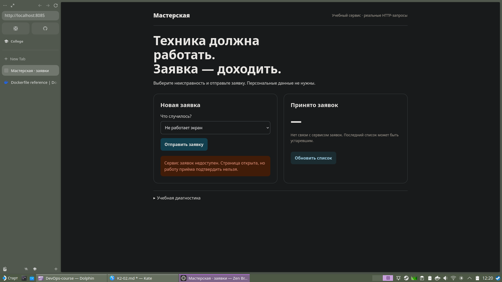

### Dockerfile
```dockerfile
FROM python:3.13-slim-bookworm
WORKDIR /app
ENV PYTHONUNBUFFERED=1 PYTHONDONTWRITEBYTECODE=1
COPY app.py index.html ./
RUN mkdir /data && chown 10001:10001 /data
USER 10001:10001
EXPOSE 8000
CMD ["python", "app.py"]
LABEL cource.student="13042007"
```
### Образ
```json
[
    {
        "Id": "sha256:b6a89b55c4d46c2bb3e9db19e39400206491c74dc5b51231394e8896c8a1e944",
        "RepoTags": [
            "devops-student:v1"
        ],
        "RepoDigests": [],
        "Parent": "sha256:6d672845d7d7e4d70e36c30efa52157bf8d3b18d6a5e02d1d69a92dac21ac3c5",
        "Comment": "",
        "Created": "2026-10-24T09:17:44.981803007Z",
        "DockerVersion": "28.3.3",
        "Author": "",
        "Architecture": "amd64",
        "Os": "linux",
        "Size": 127629059,
        "GraphDriver": {
            "Data": {
                "LowerDir": "/var/lib/docker/fuse-overlayfs/5aaf5a7f14e9069f0c7bf53607a428af4e6a3c24dd4e99674b154b939de1554b/diff:/var/lib/docker/fuse-overlayfs/9c1ff8025d00c8de3eade0c2e24b182262ad2681ecd6c2df339322336357cc72/diff:/var/lib/docker/fuse-overlayfs/275d00f83fe99dc3c9f033102aaa50eed6ca4ccacd23832dc89b2b4ee0a72f1f/diff:/var/lib/docker/fuse-overlayfs/b20b7cae13ce510ca58ac84e27ad7ed28e5a0f5664186c0a0b8da7c847b700ce/diff:/var/lib/docker/fuse-overlayfs/cca78f828e1149f58fbc864bcbaafa84a85a886c0bd2f2c0d074928d1820de06/diff:/var/lib/docker/fuse-overlayfs/9629605a329c14e18a01d19653b5e517960f1a4b63b3c8939a5abdb9341c110e/diff",
                "MergedDir": "/var/lib/docker/fuse-overlayfs/00a47c430f66e6191e7a5b21cbdddbc5df5a8751dcfb45d5e848ec4a4b66ef7f/merged",
                "UpperDir": "/var/lib/docker/fuse-overlayfs/00a47c430f66e6191e7a5b21cbdddbc5df5a8751dcfb45d5e848ec4a4b66ef7f/diff",
                "WorkDir": "/var/lib/docker/fuse-overlayfs/00a47c430f66e6191e7a5b21cbdddbc5df5a8751dcfb45d5e848ec4a4b66ef7f/work"
            },
            "Name": "fuse-overlayfs"
        },
        "RootFS": {
            "Type": "layers",
            "Layers": [
                "sha256:e58989146fcec76699871403b9897b5c014af1ccd85f5a9300a215e7975525d7",
                "sha256:ba0f973ad05d82f20d8dd8dc79a9d1b71e9d90ab48380d8c0912fad39dda5ced",
                "sha256:8664c9b18215e1141ccc8fa3cbc7483f4cd16fb5230b570fa7c744da58251da3",
                "sha256:c167899be569aee196241ae0905aeed34708881d5a8784be3de0ed9bf9db7200",
                "sha256:068879dcd0978d9c4280de1819865454474b4d9ad4c37e0e4d23b7b42a3b6683",
                "sha256:85cc2d846802e5db23a5737dc7b8d82feb4abd6b3a0e2fff224daeabac8eae4f",
                "sha256:c9c462da917ac58b9444940314dea09d86215c7985f66919ea0e6fd5431e9a4a"
            ]
        },
        "Metadata": {
            "LastTagTime": "2026-10-24T12:17:45.037565156+03:00"
        },
        "Config": {
            "Cmd": [
                "python",
                "app.py"
            ],
            "Entrypoint": null,
            "Env": [
                "PATH=/usr/local/bin:/usr/local/sbin:/usr/local/bin:/usr/sbin:/usr/bin:/sbin:/bin",
                "GPG_KEY=7169605F62C751356D054A26A821E680E5FA6305",
                "PYTHON_VERSION=3.13.16",
                "PYTHON_SHA256=f4b1bfb3c79b5bb11b8d228a12504163b4c0dab4d679828d8f5f26b6cb6ab35d",
                "PYTHONUNBUFFERED=1",
                "PYTHONDONTWRITEBYTECODE=1"
            ],
            "ExposedPorts": {
                "8000/tcp": {}
            },
            "Labels": {
                "cource.student": "13042007"
            },
            "OnBuild": null,
            "User": "10001:10001",
            "Volumes": null,
            "WorkingDir": "/app"
        }
    }
]

```
### Команда запуска
```
docker run --rm -d --name student-web -p 127.0.0.1:8085:8000 -e ROLE=web devops-student:v1
521366573b59e76f1c4ee66124d94c1e60948990780ee360da39b309fe55b252
```


## Контейнер запущен

Health: 
``` 
{"process": "running", "role": "web"}⏎  
```
Логи:
```
{"time": "2026-10-24T09:19:08.026641+00:00", "role": "web", "event": "started", "port": 8000, "instance": "521366573b59"}
{"time": "2026-10-24T09:19:17.899622+00:00", "role": "web", "event": "http", "method": "GET", "path": "/", "detail": "\"GET / HTTP/1.1\" 200 -"}
{"time": "2026-10-24T09:19:18.192875+00:00", "role": "web", "event": "http", "method": "GET", "path": "/favicon.ico", "detail": "\"GET /favicon.ico HTTP/1.1\" 404 -"}
{"time": "2026-10-24T09:19:18.716668+00:00", "role": "web", "event": "upstream_unavailable", "request_id": "1c61afa9", "target": "http://api:8000", "error": "<urlopen error [Errno -2] Name or service not known>"}
{"time": "2026-10-24T09:19:18.716835+00:00", "role": "web", "event": "http", "method": "GET", "path": "/api/requests", "detail": "\"GET /api/requests HTTP/1.1\" 503 -"}
```

