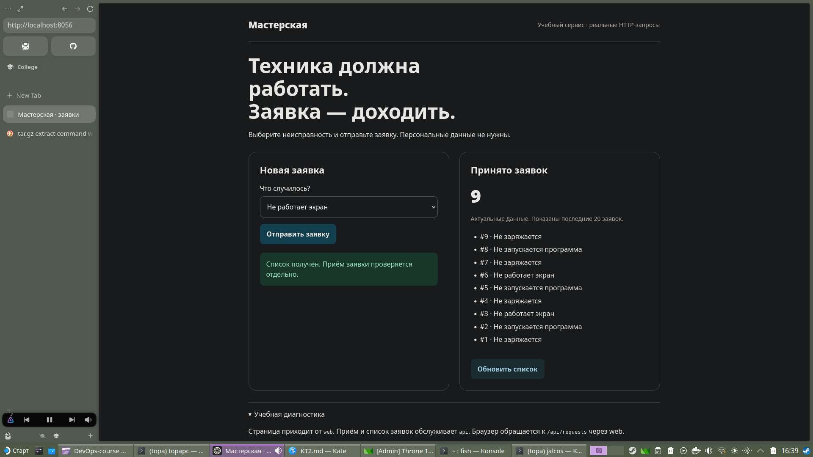
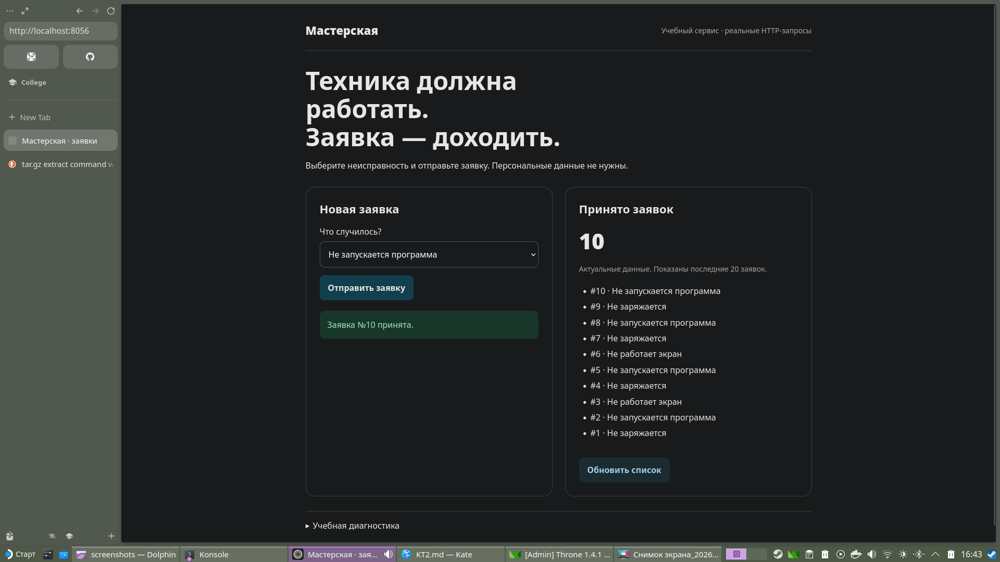

`compose.student.yaml`
```yaml
services:
    api:
        image: devops-student:v1
        pull_policy: never
        environment:
            ROLE: api
            DATA_DIR: /data
        volumes:
            - requests:/data
        healthcheck:
            test:
                [
                    "CMD",
                    "python",
                    "-c",
                    "import urllib.request; urllib.request.urlopen('http://127.0.0.1:8000/health', timeout=2)",
                ]
            interval: 3s
            timeout: 3s
            retries: 10
    web:
        image: devops-student:v1
        pull_policy: never
        environment:
            ROLE: web
            API_URL: http://api:8000
        ports:
            - "127.0.0.1:8056:8000"
        depends_on:
            api:
                condition: service_healthy
        healthcheck:
            test:
                [
                    "CMD",
                    "python",
                    "-c",
                    "import urllib.request; urllib.request.urlopen('http://127.0.0.1:8000/health', timeout=2)",
                ]
            interval: 3s
            timeout: 3s
            retries: 10
    tools:
        image: devops-course-tools:base
        pull_policy: never
        profiles: [tools]
        pid: service:api
        network_mode: service:api
        depends_on:
            api:
                condition: service_healthy
    registry:
        image: registry:3.0.0
        profiles: [registry]
        ports:
            - "127.0.0.1:5000:5000"
        volumes:
            - registry:/var/lib/registry
    prometheus:
        image: prom/prometheus:v3.13.4
        profiles: [monitoring]
        ports:
            - "127.0.0.1:9090:9090"
        volumes:
            - ./monitoring/prometheus.yml:/etc/prometheus/prometheus.yml:ro
            - prometheus:/prometheus
    grafana:
        image: grafana/grafana:13.2.3
        profiles: [monitoring]
        ports:
            - "127.0.0.1:3000:3000"
        environment:
            GF_AUTH_ANONYMOUS_ENABLED: "true"
            GF_AUTH_ANONYMOUS_ORG_ROLE: Editor
            GF_AUTH_DISABLE_LOGIN_FORM: "true"
            GF_USERS_ALLOW_SIGN_UP: "false"
        volumes:
            - ./monitoring/grafana:/etc/grafana/provisioning/datasources:ro
            - grafana:/var/lib/grafana
    ansible:
        image: devops-course-ansible:base
        pull_policy: never
        profiles: [tools]
        volumes:
            - ./ansible:/work:ro
            - requests:/data
volumes:
    requests:
    registry:
    prometheus:
    grafana:
```

Комманды:
```
docker compose -f compose.student.yaml config       
name: devops-course
services:
  api:
    environment:
      DATA_DIR: /data
      ROLE: api
    healthcheck:
      test:
        - CMD
        - python
        - -c
        - import urllib.request; urllib.request.urlopen('http://127.0.0.1:8000/health', timeout=2)
      timeout: 3s
      interval: 3s
      retries: 10
    image: devops-student:v1
    networks:
      default: null
    pull_policy: never
    volumes:
      - type: volume
        source: requests
        target: /data
        volume: {}
  web:
    depends_on:
      api:
        condition: service_healthy
        required: true
    environment:
      API_URL: http://api:8000
      ROLE: web
    healthcheck:
      test:
        - CMD
        - python
        - -c
        - import urllib.request; urllib.request.urlopen('http://127.0.0.1:8000/health', timeout=2)
      timeout: 3s
      interval: 3s
      retries: 10
    image: devops-student:v1
    networks:
      default: null
    ports:
      - mode: ingress
        host_ip: 127.0.0.1
        target: 8000
        published: "8056"
        protocol: tcp
    pull_policy: never
networks:
  default:
    name: devops-course_default
volumes:
  requests:
    name: devops-course_requests
```
```
docker compose -f compose.student.yaml up -d
[+] Running 2/2
 ✔ Container devops-course-web-1  Started                                                                        4.6s 
 ✔ Container devops-course-api-1  Healthy   
```
### Запись до перезаписи


комманды:
```
docker compose -f compose.student.yaml up -d --no-deps --force-recreate api
[+] Running 1/1
 ✔ Container devops-course-api-1  Started          
```
Старые записи сохранились, новая созданна


**Вопрос для защиты**: почему базу данных нельзя хранить только внутри контейнера, без отдельного тома? Что произойдёт с ней при пересоздании контейнера?

При пересоздании контейнера без отдельного volume база данных испарится
