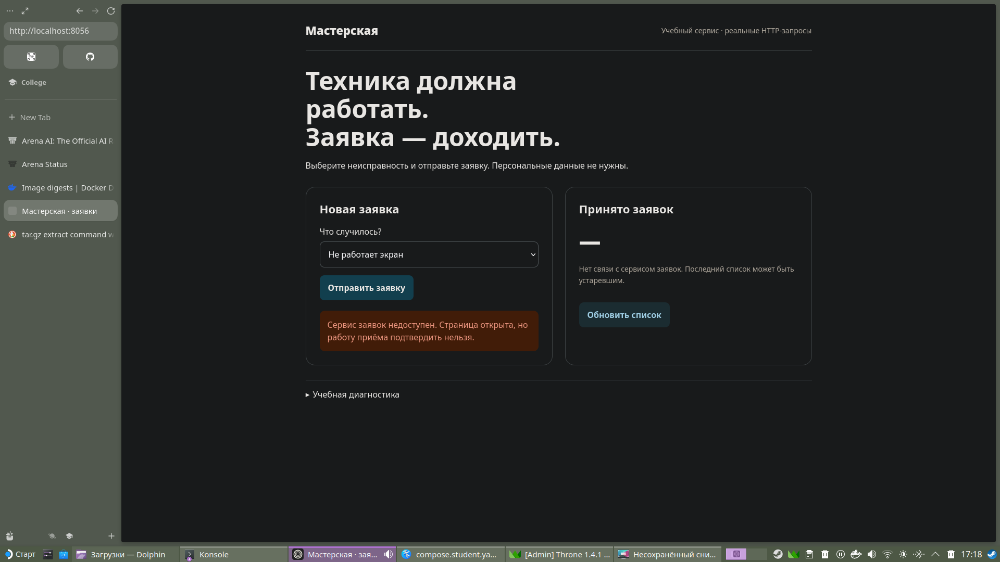

### После смены порта


**Q**: Объясните, почему возникла ошибка и как она связана с указанным портом

**A**: api находится на порту 8000, а мы паемся обратится на порт 9999, в котором ничего нет.

```
web-1  | {"time": "2026-11-12T14:27:59.746378+00:00", "role": "web", "event": "upstream_unavailable", "request_id": "5611501a", "target": "http://api:9999", "error": "<urlopen error [Errno 111] Connection refused>"}
```
